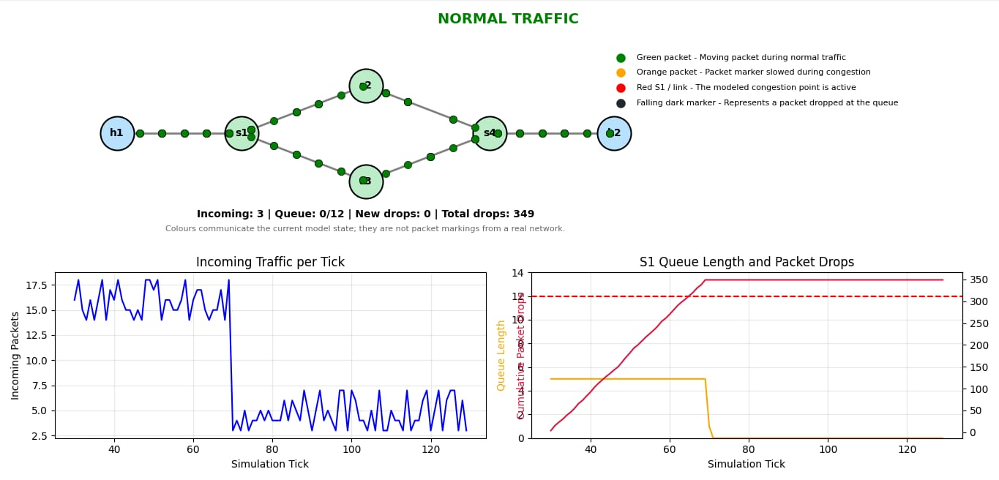
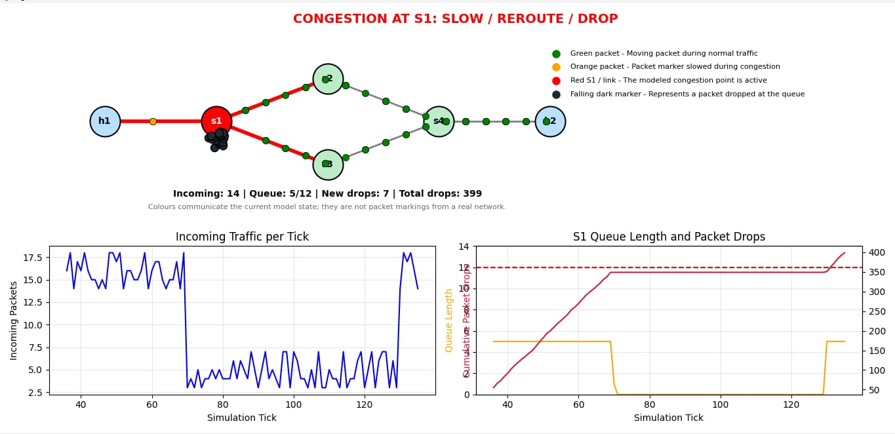

# Network Congestion Detection and Visualization

## Project Overview
This project simulates network congestion and visualizes packet movement through a network topology using Python and Matplotlib.

It demonstrates normal traffic flow, congestion detection, packet slowing, packet drops, and network traffic monitoring.

## Objectives
- Simulate network traffic.
- Detect congestion at network switches.
- Visualize packet movement.
- Demonstrate packet drops during congestion.
- Monitor traffic and queue length through graphs.

## Technologies Used
- Python
- Matplotlib
- Random module

## Features
- Animated network topology.
- Normal and congested traffic visualization.
- Packet movement visualization.
- Congestion highlighting.
- Packet drop monitoring.
- Traffic and queue graphs.

## Team Members
- Priyanka
- Ravikeerthi V
- Rakesh Badiger Ishwar

## Faculty Guide
Mohammed Asif

## Section
E

## How to Run

1. Install Python.
2. Install Matplotlib by running:
   pip install matplotlib
3. Download the project source code.
4. Open the project folder in your terminal.
5. Run the simulation using:
   python congestion_simulation.py

## Project Type
This is a Python-based network congestion simulation developed for educational purposes.

## Screenshots

### Normal Traffic

### Congestion Detected

